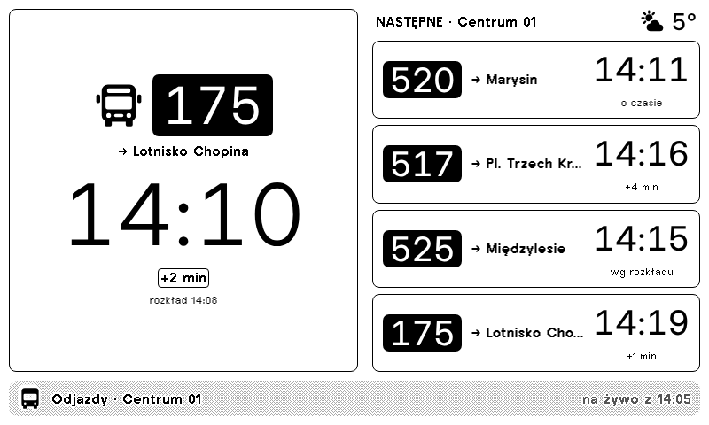

# Odjazdy WTP Warszawa

Plugin do [TRMNL](https://trmnl.com): odjazdy na żywo z dowolnego przystanku komunikacji
miejskiej w Warszawie — realna godzina odjazdu, opóźnienie względem rozkładu, kolejne kursy
i opcjonalnie mała ikona pogody z temperaturą.

*Live departures from any Warsaw (WTP) public transport stop for TRMNL e-paper displays —
real departure times, delays, next departures and an optional weather icon.*



Wszystkie widoki (TRMNL OG, TRMNL X poziomo i pionowo, połówki, ćwiartka): [docs/all-views.png](docs/all-views.png)

## Ustawienia

| Pole | Co wpisać |
|---|---|
| Przystanek | Link do przystanku z [zbiorkom.live/warsaw](https://zbiorkom.live/warsaw) (kliknij konkretny słupek, np. Centrum 01, i skopiuj adres z paska przeglądarki) albo samo ID, np. `centrum01-0fb5f` |
| Nazwa przystanku na ekranie | Np. `Centrum 01` |
| Tylko wybrane linie | Opcjonalnie, np. `175,520` |
| Pogoda w rogu ekranu | Tak / Nie |
| Miejsce pogody | Adres lub współrzędne, najlepiej okolica przystanku |

Domyślnie plugin pokazuje przystanek **Centrum 01**.

## Instalacja

### Sposób 1: ręcznie w panelu TRMNL (bez programowania)

1. trmnl.com → **Plugins → Private Plugin → New**, nadaj nazwę, np. „Odjazdy WTP”.
2. **Strategy:** `Polling`, **Polling Verb:** `GET`.
3. **Polling URL(s):** wklej obie linie z pola `polling_url` w [`src/settings.yml`](src/settings.yml) (każda w osobnym wierszu).
4. **Form Fields:** wklej całą listę spod `custom_fields:` z [`src/settings.yml`](src/settings.yml).
5. **Framework CSS version:** `v3.4.6`. **Maksymalna częstotliwość odświeżania:** co 15 min.
6. **Zapisz**, uzupełnij pola (przystanek itd.) i zapisz ponownie.
7. **Edytuj kod szablonu** i wklej pliki do zakładek:
   `full.liquid` → Full, `half_horizontal.liquid` → Half Horizontal, `half_vertical.liquid` → Half Vertical,
   `quadrant.liquid` → Quadrant, `shared.liquid` → Shared, `transform.js` → Transform (Serverless, Node).
8. Dodaj plugin do playlisty.

### Sposób 2: [trmnlp](https://github.com/usetrmnl/trmnlp)

```bash
git clone https://github.com/Szansor/trmnl-plugins-public
cd trmnl-plugins-public/odjazdy-wtp
trmnlp serve   # podgląd lokalny na http://localhost:4567
trmnlp login   # potem: trmnlp push
```

## Jak to działa

- TRMNL co 15 min pobiera dwa adresy (strategia *Polling*):
  - `api.zbiorkom.live/api6-open/warsaw/stops/{ID}` — odjazdy z opóźnieniami,
  - `api.open-meteo.com` — aktualna pogoda.
- `transform.js` (Serverless, Node) wybiera 7 najbliższych odjazdów, liczy realną godzinę
  (rozkład + opóźnienie) i zamienia kod pogody na ikonę.
- Wygląd to wyłącznie klasy TRMNL Framework 3.4.6, bez własnego CSS. Są 4 widoki,
  wersje dla TRMNL OG (1-bit i 2-bit) i TRMNL X oraz tryb pionowy.
- Ekran e-papieru nie odświeża się co minutę, dlatego plugin pokazuje godziny odjazdu
  (a nie odliczanie) i godzinę pobrania danych.
- Jeśli plugin pokaże „Nie znaleziono przystanku”, skopiuj link do przystanku ponownie.

## Pliki

```
src/
  settings.yml           ustawienia, adresy danych i pola formularza
  shared.liquid          ikony, nazwa przystanku, ekran błędu
  full.liquid            pełny ekran
  half_horizontal.liquid pół ekranu poziomo
  half_vertical.liquid   pół ekranu pionowo
  quadrant.liquid        ćwiartka
  transform.js           przetwarzanie danych (Serverless, Node)
```

## Źródła danych

- Odjazdy: [zbiorkom.live](https://zbiorkom.live) (otwarte dane WTP / m.st. Warszawy)
- Pogoda: [Open-Meteo](https://open-meteo.com)
